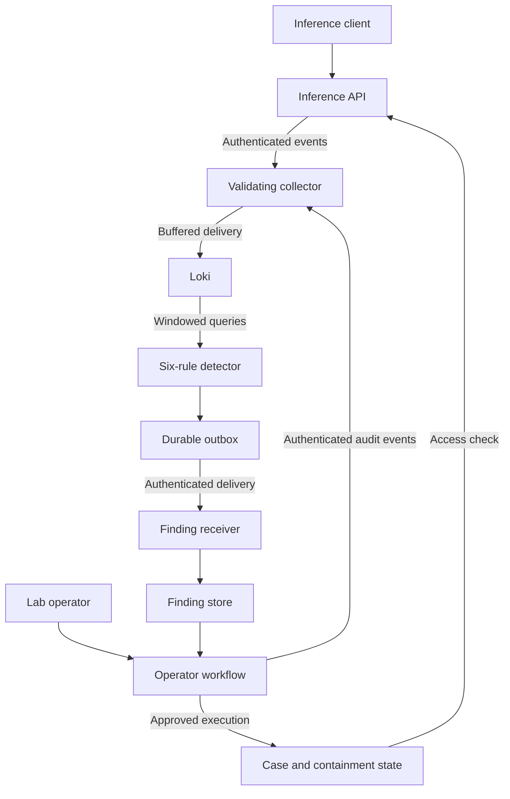
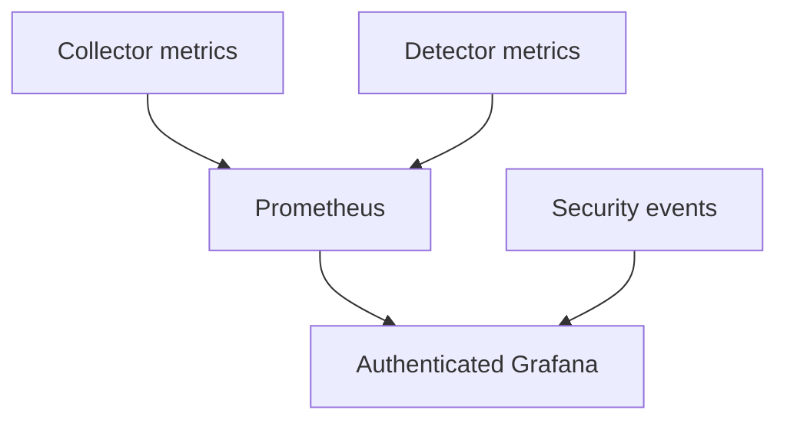

# System Architecture

## Scope

Project 10 is a standalone local AI security monitoring laboratory.
An authenticated API runs an actual classifier trained on synthetic data.
Both model names expose the same classifier under different access policies.
No cloud account or separate inference backend is required.

## Application and Security Flow

The collector authenticates producers and restricts source and provenance.
The detector evaluates stored events and queues findings before delivery.
Receiver acknowledgment confirms storage, not analyst review or malicious intent.

The workflow separates analyst, approver, and responder credentials.
One researcher operates these synthetic principals; this is not independent
human review.

Containment blocks one caller/model pair for 60 seconds. Expiry is evaluated
during access checks. Requests already in flight are not canceled.

## Monitoring Flow

Prometheus collects operational metrics. Grafana queries Prometheus and Loki.
The security operations dashboard contains 16 panels.

Scrape health, query health, delivery health, and polling freshness are separate
signals. Dashboard query success does not establish detection effectiveness.

## Trust Boundaries

| Boundary | Implemented control | Limitation |
|---|---|---|
| Client to inference | Authentication, authorization, admission, containment | Admission is process-local |
| Producer to collector | Credentials and source/provenance binding | Authorized producers can fabricate permitted statements |
| Collector to storage | Bounded retries and buffering | Pending memory is lost on termination |
| Direct Loki access | Loopback host publication | Unauthenticated writes bypass collector controls |
| Detector to receiver | Authentication and validated receipt | Storage acknowledgment is not analyst review |
| Operator to response | Roles, approval, fixed scope, single execution | Approval has no separate freshness deadline |
| Application to local state | Private SQLite files | Host compromise is outside the protection boundary |

Loki is unauthenticated. Local processes and Compose-network peers with direct
access can fabricate detector inputs. End-to-end authenticated or tamper-resistant
telemetry is not claimed.

## Persistence and Evidence

Collector pending events and duplicate state are in memory.
Loki, Prometheus, and Grafana use named Docker volumes.
Loki and Prometheus have configured 24-hour retention policies; deletion is not
an exact wall-clock guarantee.

Findings, the outbox, and cases use private host-side SQLite files.
Finding stores have bounded capacity and no automatic archival.
Exported research evidence is separate from monitoring retention.

The frozen evaluation used 124 actual inference requests across four scenarios.
The response retest correlated 21 inference decisions and five operator actions.

See [Validation](validation.md), [Response Retest](response-retest.md),
[Telemetry Integrity](telemetry-integrity.md), and
[Residual Risks](residual-risks.md).
