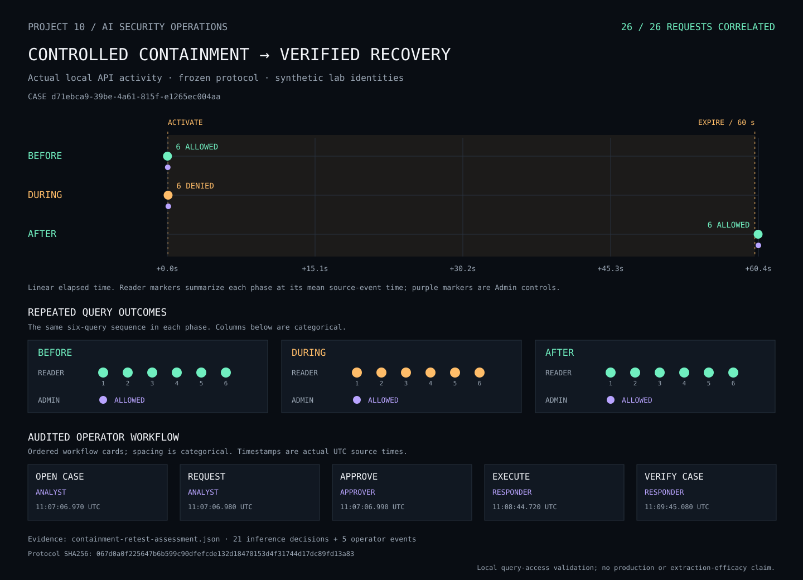

# Evidence-Linked Response Retest

## Threat Model

An authenticated caller can use permitted inference queries to collect model
outputs. A response must restrict the approved target without unnecessarily
blocking other authorized access.

Detection findings require investigation and authorization; they do not
independently establish malicious intent.

## Mitigation

**Status: Tested — controlled local query-access retest.**

A case linked to the assessed H03 burst-replication finding authorized a
60-second block for lab-caller-reader accessing research-model.

Separate analyst, approver, and responder credentials enforced the workflow.
One researcher operated all three principals.

## Frozen Protocol

Protocol: config/evaluation/containment-retest.json

SHA256:
067d0a0f225647b6b599c90dfefcde132d18470153d4f31744d17dc89fd13a83

The protocol repeated six fixed queries before, during, and after containment,
with one Admin control request in each phase.

Request budgets:

- 21 inference requests.
- Five operator requests.
- No automatic HTTP retries.

The original held-out manifest and assessment were preserved.

## Validation

| Phase | Reader / research-model | Admin / restricted-model |
|---|---|---|
| Before containment | Six successful predictions | One successful prediction |
| During containment | Six HTTP 403 containment denials | One successful prediction |
| After expiry | Six successful predictions | One successful prediction |

Preparation passed five checks. Traffic execution passed seven checks.
The final assessment passed eight checks.

All 26 request IDs correlated to distinct stored security events:

- 21 inference decisions.
- Five successful operator operations.

The same six-query sequence was verified in every phase.
Reader event timestamps aligned with activation and expiry.

The case history preserved creation, containment request, approval, and execution
with the expected operator roles.

## Evidence

- [Frozen protocol](../config/evaluation/containment-retest.json)
- [Protocol checksum](../config/evaluation/containment-retest.sha256)
- [Preparation](../evidence/public/containment-retest-preparation.json)
- [Execution](../evidence/public/containment-retest-execution.json)
- [Assessment and correlated events](../evidence/public/containment-retest-assessment.json)

## Residual Risks

- This was a small query-access retest, not a repeated extraction experiment.
- No new replica-agreement or detection-performance measurement was made.
- Both exposed model names use the same classifier with different access policies.
- Containment blocks legitimate activity by the selected caller as well.
- In-flight requests are not canceled.
- Policy checking and model execution are separate operations.
- Local credentials, clock, and policy storage remain trust dependencies.
- Separate credentials do not demonstrate independent human review.
- Correlation does not establish tamper-resistant logging or production response
  effectiveness.

## Investigation Visualization



The upper timeline uses actual elapsed source-event time. Reader markers
summarize each phase; purple markers represent successful Admin controls.

The query matrix shows individual outcomes for the same six-query sequence.
Its columns and the operator workflow cards are categorical, not elapsed-time
scales.

The visualization is generated from the verified assessment and frozen protocol.
It remains available independently of Loki retention.

Regenerate with:

```bash
python -m scripts.export_containment_timeline
```
